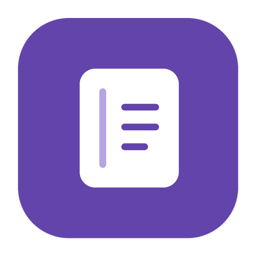

# Splash screen en Flutter

La pantalla de arranque, o *splash screen*, es lo primero que ves al abrir una app desde su icono. En esta guía configurarás el fondo y el icono de «Notas personales» en Android e iOS. Después comprobarás cómo la pantalla de arranque da paso a «Mis notas», la primera pantalla de Flutter.

> **Punto de partida.** Abre un proyecto Flutter que ya se ejecute en un emulador o dispositivo Android. Para comprobar también iOS, necesitarás macOS con Xcode y un simulador o dispositivo.

## Qué controla cada capa

Android e iOS muestran la pantalla de arranque mientras Flutter se inicializa. Cuando Flutter dibuja su primer fotograma, aparece la interfaz que has definido en Dart. Si después la app necesita descargar notas de un servidor, muestra el estado de carga dentro de esa interfaz.

En la [guía de Compose](../compose-splash-screen/) configuramos el tema de arranque de Android en XML. Aquí usarás un archivo YAML y `flutter_native_splash` para generar los recursos que leen los dos sistemas.

## Añade el generador

Desde la carpeta que contiene `pubspec.yaml`, ejecuta:

```bash
flutter pub add --dev flutter_native_splash
```

El comando añade el paquete a `dev_dependencies`. En este ejemplo lo usarás para generar los archivos de arranque y podrás mantener tu llamada habitual a `runApp()`.

## Define el icono y el fondo

Crea la carpeta `assets/` en la raíz del proyecto y guarda los dos PNG del ejemplo. La [imagen general](ejemplo/assets/splash.png) mide 512 × 512 píxeles y se usa en iOS y en Android anterior a 12. La [imagen para Android 12 y posteriores](ejemplo/assets/splash_android12.png) mide 1152 × 1152 píxeles.

<figure class="lesson-figure lesson-figure--compact">
    
    <figcaption>Las dos imágenes usan el mismo dibujo con márgenes distintos. El margen de la versión para Android 12 deja espacio para el recorte circular del sistema.</figcaption>
</figure>

Crea `flutter_native_splash.yaml` junto a `pubspec.yaml`. Las rutas de las imágenes parten de la raíz del proyecto.

```yaml
flutter_native_splash:
  color: "#F3F0FF"
  color_dark: "#1D1929"
  image: assets/splash.png
  web: false

  android_12:
    color: "#F3F0FF"
    color_dark: "#1D1929"
    image: assets/splash_android12.png
```

Android 12 (API 31) y posteriores leen la configuración del bloque `android_12`. El sistema usa un fondo de color sólido y recorta el icono en un círculo. Si sustituyes el PNG de 1152 × 1152, mantén el dibujo dentro del círculo central de 768 píxeles de diámetro. Esta medida corresponde al caso del ejemplo, que deja sin configurar el fondo opcional del icono. [Documentación de flutter_native_splash](https://pub.dev/packages/flutter_native_splash#android-12-and-later).

`color_dark` define el fondo cuando el sistema está en modo oscuro. Una preferencia de apariencia guardada dentro de la app se aplica cuando Flutter carga su interfaz. El generador lee los PNG directamente de sus rutas. Si también vas a usarlos con `Image.asset`, decláralos en la sección `flutter.assets` de `pubspec.yaml`.

## Genera los archivos de arranque

Ejecuta el generador desde la raíz del proyecto:

```bash
dart run flutter_native_splash:create
```

En Android puedes revisar los cambios en `android/app/src/main/res/`. En iOS, revisa `ios/Runner/Base.lproj/LaunchScreen.storyboard` y los recursos de `ios/Runner/Assets.xcassets/`. Vuelve a ejecutar el comando cada vez que cambies el YAML o los PNG.

## Da paso a la primera pantalla de Flutter

Si estás trabajando en un proyecto de prueba, sustituye `lib/main.dart` por este ejemplo. Sigue el tema del sistema y usa para la primera pantalla el mismo color de fondo que la splash. Así puedes comprobar la transición a «Mis notas».

```dart
import 'package:flutter/material.dart';

void main() {
  runApp(const NotasApp());
}

class NotasApp extends StatelessWidget {
  const NotasApp({super.key});

  @override
  Widget build(BuildContext context) {
    return MaterialApp(
      title: 'Notas personales',
      theme: ThemeData(scaffoldBackgroundColor: const Color(0xFFF3F0FF)),
      darkTheme: ThemeData(
        brightness: Brightness.dark,
        scaffoldBackgroundColor: const Color(0xFF1D1929),
      ),
      themeMode: ThemeMode.system,
      home: const Scaffold(body: Center(child: Text('Mis notas'))),
    );
  }
}
```

Si ya tienes una app, conserva tu primera pantalla y comprueba su color de fondo en ambos modos. Deja que el primer fotograma marque el fin de la splash y evita introducir un retraso fijo para que se vea durante más tiempo.

## Comprueba el arranque

Detén la ejecución y vuelve a compilar e instalar con `flutter run`. La recarga en caliente actualiza el código Dart, mientras que estos cambios se incorporan a los recursos nativos durante la compilación.

1. En Android, fuerza la detención desde Ajustes y abre la app desde su icono. Observa cómo el cuaderno centrado da paso a «Mis notas». Si puedes, repite la prueba en Android 12 o posterior y en una versión anterior compatible.
2. En iOS, cierra por completo la app desde el selector de apps y vuelve a abrirla desde su icono.
3. Cambia el sistema a modo oscuro y repite el arranque en cada plataforma que tengas disponible. Comprueba el fondo y que el dibujo queda completo.

Si Android 12 muestra el icono del lanzador en lugar del cuaderno, revisa la ruta de `android_12.image` y vuelve a generar e instalar. Si ves un destello al empezar Flutter, compara `color` y `color_dark` con el fondo que realmente pinta tu primer `Scaffold`.

## Archivos y referencias

- [Instrucciones y archivos del ejemplo](ejemplo/README.md).
- [Pantalla de arranque en Android](https://docs.flutter.dev/platform-integration/android/splash-screen).
- [Pantalla de arranque en iOS](https://docs.flutter.dev/platform-integration/ios/launch-screen).
- [Configuración de flutter_native_splash](https://pub.dev/packages/flutter_native_splash).
